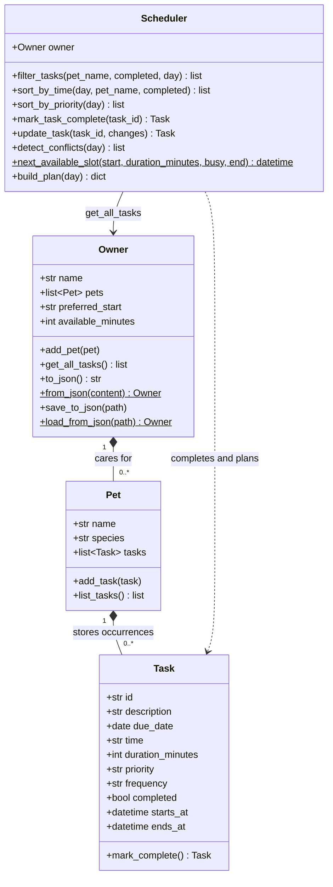

# 🐾 PawPal+

A pet care app for tracking tasks and planning time across multiple pets.

Built for CodePath AI110 Project 2 from the [official starter](https://github.com/codepath/ai110-module2show-pawpal-starter). This repository is a fork with incremental design, backend, scheduling, interface, and verification commits.

## Features

- Add multiple pets, create and edit dated care tasks, and assign durations and priorities.
- View chronological tasks with pet and completion filters.
- Warn about overlapping activities across all pets, including midnight spillovers.
- Complete one-time, daily, or weekly tasks; recurring completion creates exactly one next occurrence.
- Generate an explained, priority-first plan inside a chosen care window; view deferred tasks that do not fit.
- Automatically save pets and tasks to local `data.json` between runs, with downloadable JSON backups as an extra copy.
- Try a sample two-pet household in one click.

## Setup and run

Python **3.12** was used for local verification. The GitHub workflow also checks Python 3.11.

```bash
python3 -m venv .venv
source .venv/bin/activate
# Windows PowerShell: .\.venv\Scripts\Activate.ps1
python -m pip install -r requirements.txt
python main.py
python -m streamlit run app.py
```

Open the local address printed by Streamlit, usually `http://localhost:8501`. For the exact dependency versions used during this implementation, install `requirements-lock.txt` instead of `requirements.txt` in a Python 3.12 virtual environment. The original requirements remain the two direct dependencies, Streamlit and pytest.

No API key or paid service is required. `main.py` uses a fixed demonstration date so its output is reproducible; the UI defaults to the current day.

## System design

| Class | Responsibility |
| --- | --- |
| `Task` | Validated description, local date/time, duration, priority, frequency, completion and stable ID. Returns the next occurrence on first completion. |
| `Pet` | Identification and a collection of care occurrences; adds and lists tasks. |
| `Owner` | Household and care-window preferences; `get_all_tasks()` aggregates every pet's tasks; JSON backup/restore. |
| `Scheduler` | Reads the Owner aggregation, filters/sorts, completes/edits occurrences, detects conflicts, and builds plans. |

The domain lives in `pawpal_system.py` without Streamlit imports. `main.py` and `app.py` share it. The owner is stored in `st.session_state` during UI reruns and automatically saved to `data.json` after changes; fresh sessions restore it from disk. Stable task IDs distinguish tasks with identical descriptions.

Draft: [`diagrams/uml_draft.mmd`](diagrams/uml_draft.mmd). Final: [`diagrams/uml_final.mmd`](diagrams/uml_final.mmd). `diagrams/uml.mmd` is an identical convenient copy of the final diagram.



## Smarter Scheduling

| Feature | Method | Behavior |
| --- | --- | --- |
| Multi-pet aggregation | `Owner.get_all_tasks()` | Returns `(pet, task)` pairs across the household. |
| Time sorting | `Scheduler.sort_by_time()` | Date plus HH:MM ordering, preserving stored order. |
| Filtering | `Scheduler.filter_tasks()` | Combine pet, completion status and due date. |
| Priority sorting | `Scheduler.sort_by_priority()` | Pending tasks: high, medium, low; due time breaks ties. |
| Conflicts | `Scheduler.detect_conflicts()` | Overlapping pending duration intervals across all pets; touching ends are allowed. |
| Recurrence | `Scheduler.mark_task_complete()` and `Task.mark_complete()` | Daily +1 day or weekly +7 days from the due date; idempotent repeated completion. |
| Free time blocks | `Scheduler.next_available_slot()` | Earliest gap that fits a task without overlap. |
| Priority plan | `Scheduler.build_plan()` | Pending due/overdue tasks, priority-first allocation, chronological result, explicit deferred list. |
| Safe edits | `Scheduler.update_task()` | Validate a replacement before changing stored data; completed history is read-only. |

### Planning rules and tradeoffs

The care window starts at the owner's chosen time and ends after the chosen number of minutes, or at midnight. High-priority tasks get slots first. Requested times are earliest starts, not deadlines. Pending overdue tasks are included; future and completed tasks are not.

The plan is a suggestion and does not change saved task times. Conflicts describe the original schedule, so a warning can still appear beside a suggested plan that avoids the overlap. The app assumes one caregiver and local times. It does not handle travel, time zones, or multiple caregivers.

The greedy planner is simple but does not always find the best possible combination of tasks. Inputs are checked for blank names, invalid times and durations, duplicate pet names, and duplicate imported task IDs.

## Sample Output

Actual output of `python main.py`. The separate mixed-priority example places a 10:00 high-priority appointment before an 08:00 low-priority play task, while the two high-priority tasks remain ordered by time:

```text
PawPal+ | Jordan | 2026-10-20

Today's Schedule
Time    Pet        Task                     Mins  Priority Status
--------------------------------------------------------------------------
08:00   Mochi      Breakfast                  10  high     Pending
08:00   Biscuit    Morning walk               30  high     Pending
09:00   Biscuit    Grooming                   20  medium   Pending
10:00   Mochi      Enrichment play            25  low      Pending

Priority order | high, medium, low; then due time
Time    Pet        Task                     Mins  Priority Status
--------------------------------------------------------------------------
09:00   Biscuit    Morning walk               30  high     Pending
10:00   Mochi      Vet appointment            30  high     Pending
09:30   Biscuit    Grooming                   20  medium   Pending
08:00   Mochi      Play                       20  low      Pending

Biscuit's pending tasks
Time    Pet        Task                     Mins  Priority Status
--------------------------------------------------------------------------
08:00   Biscuit    Morning walk               30  high     Pending
09:00   Biscuit    Grooming                   20  medium   Pending
WARNING: 2026-10-20 08:00 Mochi: Breakfast overlaps 2026-10-20 08:00 Biscuit: Morning walk.

Priority plan | 08:00–10:00 | no overlapping care
Time    Pet        Task                     Mins  Priority Status
--------------------------------------------------------------------------
08:00   Mochi      Breakfast                  10  high     Pending
08:10   Biscuit    Morning walk               30  high     Pending
09:00   Biscuit    Grooming                   20  medium   Pending
DEFERRED: Mochi: Enrichment play. No remaining slot in the care window.

Completed Breakfast; next daily occurrence: 2026-10-21 08:00.
```

## Demo Walkthrough

1. Run `python -m streamlit run app.py`. The empty household shows clear next steps.
2. In the sidebar, click **Load sample household** to get Mochi, Biscuit, and four intentionally unsorted care tasks. Existing households require confirmation before sample replacement.
3. In **Today's care**, the chronological list shows both pets, task details and an overlap warning for Breakfast and Morning walk at 08:00. Use **Show pet** and **Show status** to filter.
4. Click **Generate priority plan**. With the default 08:00–10:00 window, breakfast occupies 08:00–08:10, the walk moves to 08:10–08:40, and grooming stays at 09:00. The 10:00 play task is explicitly deferred because it ends after the window.
5. Click **Complete** beside Breakfast. The current occurrence becomes completed and a pending breakfast for the following day is added. Change the schedule date to see it; use the Completed filter to see history.
6. Open **Pets & tasks** to add a pet, create a task with a due date/time, duration, priority and repetition, or edit a pending task. Invalid submissions show inline errors.
7. Save a different owner name, start time or window length in the sidebar; the pets and tasks remain intact.
8. Open **Backup**, download an extra household backup, and restore it when needed after checking **Replace my current household with this backup**.

## Persistence

The app automatically saves each household change to **`data.json`** beside `app.py`, using `Owner.save_to_json()`. On startup or in a fresh browser session, it calls `Owner.load_from_json()` to restore pets, tasks, completion history, IDs, and preferences. Add a pet or task, stop Streamlit, restart it, and the household is still there. The local data file is excluded from Git.

Serialization uses a custom dictionary conversion: `dataclasses.asdict()` converts the nested Owner/Pet/Task objects, dates become ISO strings, and `from_json()` rebuilds validated dataclasses and converts ISO dates back to `date` objects. A version field allows incompatible backups to be rejected. No additional serialization library is required.

The **Backup** tab downloads an extra copy or restores a chosen backup after confirmation; successful restoration also updates `data.json`. Invalid saved data is not silently overwritten. A save failure is shown explicitly rather than reporting success. UI imports must be smaller than 1 MB.

This is a single-household local app. All sessions connected to the same server use the same file; concurrent independent households require a database and account model. Tests use an isolated temporary path through `PAWPAL_DATA_FILE`, so they never overwrite the real household.

For file persistence from Python:

```python
from main import build_demo
from pawpal_system import Owner

owner = build_demo()
owner.save_to_json("data.json")
restored = Owner.load_from_json("data.json")
assert restored == owner
```

`save_to_json()` writes to a temporary sibling then replaces the destination. Backups preserve date values, IDs, history, recurrence, pets and preferences. Invalid/unsupported backups raise `ValueError`. Modified files: `pawpal_system.py` implements serialization and file methods; `app.py` loads on startup and saves each change; `tests/test_pawpal.py` and `tests/test_app.py` verify round trips, fresh-session restoration, and failure handling; `.gitignore` excludes saved household data. User backups and local environments are excluded from Git.

## Professional UI and Output Formatting (Challenge 4)

- `main.print_schedule()` uses Python f-string field widths to create aligned CLI columns for time, pet, task, duration, priority, and status. This provides structured tables without another dependency such as `tabulate`.
- `app.py` uses Streamlit's `st.metric()` for household totals, `st.container(border=True)` for task cards, `st.dataframe()` for pet information, and `st.tabs()` to separate daily care, task management, and backups.
- `st.success()`, `st.warning()`, and `st.error()` distinguish confirmations, conflicts/deferred tasks, and invalid input. Text labels carry the meaning as well as color.
- The paw-print icon and `.streamlit/config.toml` provide consistent branding, a green primary color, cream background, and readable text.
- CLI output for both priority ordering and conflict-free time blocking appears in **Sample Output** above; the screenshot is supplementary.

## Challenge Checklist

| Challenge | Implementation and evidence |
| --- | --- |
| 1. Advanced algorithm + Agent Workflow | `Scheduler.next_available_slot()` / `build_plan()`; explicit task, modified files, completed work, and corrections in `ai_interactions.md`. |
| 2. Data persistence | `Owner.save_to_json()` / `load_from_json()`; app automatically saves/restores `data.json`; persistence workflow and modified files documented above. |
| 3. Priority scheduling | `Task.priority` and `Scheduler.sort_by_priority()`; explicit high/medium/low ordering then due time in the CLI output above. |
| 4. Professional output | Aligned CLI tables, Streamlit status colors/cards/metrics, and theme; functions and libraries documented above. |
| 5. Two-model comparison | Independent GPT-6 Sol and GPT-6.1 Sol responses, shared prompt, usefulness/limits, identical tests, and final decision in `ai_interactions.md`; returned code retained in `comparisons/`. |

## Testing PawPal+

```bash
python -m pytest
# Concise result:
python -m pytest -q
```

Actual concise test output from this implementation:

```text
.........................................................                [100%]
57 passed in 1.35s
```

The suite covers the four classes, aggregation across pets, completion, chronological and priority ordering, combined filters, recurrence and duplicate completion, overlapping/adjacent/midnight tasks, atomic edits, invalid data, empty schedules, duplicate IDs, slot fitting and care-window boundaries, overdue/future/completed behavior, JSON round trips and malformed backups. Additional tests verify automatic storage across new UI sessions, persistence errors, and both independent model responses using identical recurrence checks. Streamlit AppTest exercises real form submissions and session reruns for adding/editing/completing tasks, filtering, sample replacement confirmation, plan generation and preferences. `python main.py` is an independent end-to-end CLI demonstration.

**Confidence level: ★★★★☆ (4/5).** The tests cover the main behaviors. More testing could cover large imports, more browsers, and keyboard-only use.

GitHub Actions runs dependency checks, pytest and the CLI demo on each push/PR. [`reflection.md`](reflection.md) covers design decisions, tradeoffs, and AI-assisted development; [`ai_interactions.md`](ai_interactions.md) summarizes the development workflow and useful refinements.

## Verified application

[GitHub checks passed on Python 3.11 and 3.12](https://github.com/Mathewlewisagani/ai110-module2show-pawpal-starter/actions/runs/39512246810). See [the verification record](docs/verification.md) for the tested commit, real browser checks, and backup restore walkthrough.

## Project deliverables

Included: four classes, draft and final UML, multi-pet scheduling, a CLI demo, tests, Streamlit UI, and reflection. The extra features are next-slot planning, priority scheduling, JSON persistence, formatted output, and a two-model comparison.
