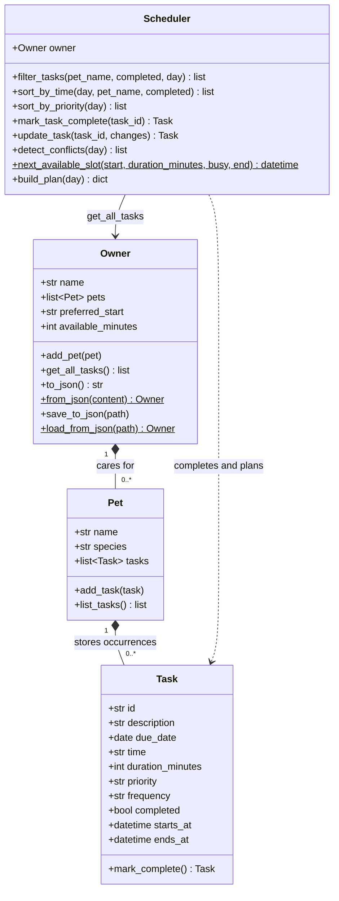
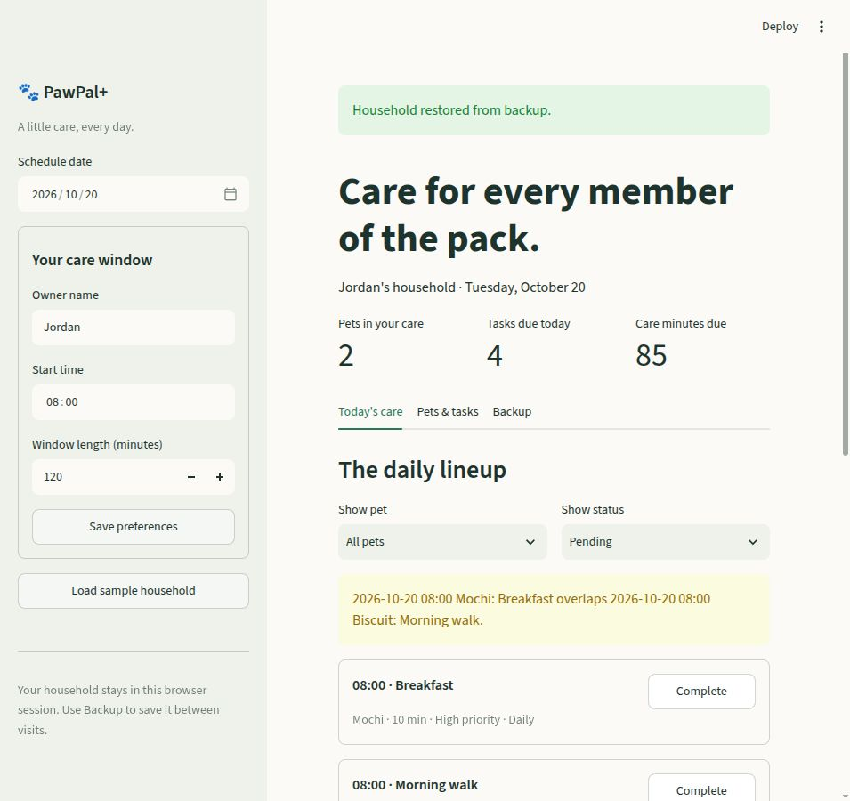

# 🐾 PawPal+

A small care planner for a busy household: track every pet, see what is due, and make room for the most important tasks.

Built for CodePath AI110 Project 2 from the [official starter](https://github.com/codepath/ai110-module2show-pawpal-starter). This repository is a fork with incremental design, backend, scheduling, interface, and verification commits.

## Features

- Add multiple pets, create and edit dated care tasks, and assign durations and priorities.
- View chronological tasks with pet and completion filters.
- Warn about overlapping activities across all pets, including midnight spillovers.
- Complete one-time, daily, or weekly tasks; recurring completion creates exactly one next occurrence.
- Generate an explained, priority-first plan inside a chosen care window; view deferred tasks that do not fit.
- Download/restore a versioned JSON household backup or save/load the same data from Python.
- Try a sample two-pet household in one click.

## Setup and run

Python **3.12** was used for local verification. The GitHub workflow also checks Python 3.11.

```bash
python3 -m venv .venv
source .venv/bin/activate
# Windows PowerShell: .\.venv\Scripts\Activate.ps1
python -m pip install -r requirements.txt
python main.py
python -m streamlit run app.py
```

Open the local address printed by Streamlit, usually `http://localhost:8501`. For the exact dependency versions used during this implementation, install `requirements-lock.txt` instead of `requirements.txt` in a Python 3.12 virtual environment. The original requirements remain the two direct dependencies, Streamlit and pytest.

No API key or paid service is required. `main.py` uses a fixed demonstration date so its output is reproducible; the UI defaults to the current day.

## System design

| Class | Responsibility |
| --- | --- |
| `Task` | Validated description, local date/time, duration, priority, frequency, completion and stable ID. Returns the next occurrence on first completion. |
| `Pet` | Identification and a collection of care occurrences; adds and lists tasks. |
| `Owner` | Household and care-window preferences; `get_all_tasks()` aggregates every pet's tasks; JSON backup/restore. |
| `Scheduler` | Reads the Owner aggregation, filters/sorts, completes/edits occurrences, detects conflicts, and builds plans. |

The domain lives in `pawpal_system.py` without Streamlit imports. `main.py` and `app.py` share it. The owner is stored in `st.session_state` so normal UI reruns preserve the household. Stable task IDs distinguish tasks with identical descriptions.

Draft: [`diagrams/uml_draft.mmd`](diagrams/uml_draft.mmd). Final: [`diagrams/uml_final.mmd`](diagrams/uml_final.mmd). `diagrams/uml.mmd` is an identical convenient copy of the final diagram.



## Smarter Scheduling

| Feature | Method | Behavior |
| --- | --- | --- |
| Multi-pet aggregation | `Owner.get_all_tasks()` | Returns `(pet, task)` pairs across the household. |
| Time sorting | `Scheduler.sort_by_time()` | Date plus HH:MM ordering, preserving stored order. |
| Filtering | `Scheduler.filter_tasks()` | Combine pet, completion status and due date. |
| Priority sorting | `Scheduler.sort_by_priority()` | Pending tasks: high, medium, low; due time breaks ties. |
| Conflicts | `Scheduler.detect_conflicts()` | Overlapping pending duration intervals across all pets; touching ends are allowed. |
| Recurrence | `Scheduler.mark_task_complete()` and `Task.mark_complete()` | Daily +1 day or weekly +7 days from the due date; idempotent repeated completion. |
| Free time blocks | `Scheduler.next_available_slot()` | Earliest gap that fits a task without overlap. |
| Priority plan | `Scheduler.build_plan()` | Pending due/overdue tasks, priority-first allocation, chronological result, explicit deferred list. |
| Safe edits | `Scheduler.update_task()` | Validate a replacement before changing stored data; completed history is read-only. |

### Planning rules and tradeoffs

The care window runs from the owner's preferred start for the specified number of minutes, clipped at midnight. The window is elapsed time, including gaps between activities. Requested times are **earliest starts**, not hard deadlines. Overdue tasks may start at the beginning of the selected day's window. Future and completed tasks are excluded. Priority takes precedence over maximizing task count. The greedy algorithm is predictable, not a global optimizer.

Plans contain suggested task copies and explanations; they never overwrite original requested times. Conflict warnings describe the original task schedule, so they can still appear alongside a conflict-free suggested plan. One caregiver is assumed. Times are naive local calendar values: time zones, DST, travel, multiple caregivers and strict timing constraints are outside scope.

Sorting/filtering cost O(n log n)/O(n). Conflict detection and incremental gap fitting are O(n²) in the worst case, appropriate for a small household. Data validation rejects blank names/descriptions, malformed times, invalid durations and frequencies, duplicate pet names and duplicate imported task IDs.

## Sample Output

Actual output of `python main.py`:

```text
PawPal+ | Jordan | 2026-10-20

Today's Schedule
Time    Pet        Task                     Mins  Priority Status
--------------------------------------------------------------------------
08:00   Mochi      Breakfast                  10  high     Pending
08:00   Biscuit    Morning walk               30  high     Pending
09:00   Biscuit    Grooming                   20  medium   Pending
10:00   Mochi      Enrichment play            25  low      Pending

Biscuit's pending tasks
Time    Pet        Task                     Mins  Priority Status
--------------------------------------------------------------------------
08:00   Biscuit    Morning walk               30  high     Pending
09:00   Biscuit    Grooming                   20  medium   Pending
WARNING: 2026-10-20 08:00 Mochi: Breakfast overlaps 2026-10-20 08:00 Biscuit: Morning walk.

Priority plan | 08:00–10:00 | no overlapping care
Time    Pet        Task                     Mins  Priority Status
--------------------------------------------------------------------------
08:00   Mochi      Breakfast                  10  high     Pending
08:10   Biscuit    Morning walk               30  high     Pending
09:00   Biscuit    Grooming                   20  medium   Pending
DEFERRED: Mochi: Enrichment play. No remaining slot in the care window.

Completed Breakfast; next daily occurrence: 2026-10-21 08:00.
```

## Demo Walkthrough

1. Run `python -m streamlit run app.py`. The empty household shows clear next steps.
2. In the sidebar, click **Load sample household** to get Mochi, Biscuit, and four intentionally unsorted care tasks. Existing households require confirmation before sample replacement.
3. In **Today's care**, the chronological list shows both pets, task details and an overlap warning for Breakfast and Morning walk at 08:00. Use **Show pet** and **Show status** to filter.
4. Click **Generate priority plan**. With the default 08:00–10:00 window, breakfast occupies 08:00–08:10, the walk moves to 08:10–08:40, and grooming stays at 09:00. The 10:00 play task is explicitly deferred because it ends after the window.
5. Click **Complete** beside Breakfast. The current occurrence becomes completed and a pending breakfast for the following day is added. Change the schedule date to see it; use the Completed filter to see history.
6. Open **Pets & tasks** to add a pet, create a task with a due date/time, duration, priority and repetition, or edit a pending task. Invalid submissions show inline errors.
7. Save a different owner name, start time or window length in the sidebar; the pets and tasks remain intact.
8. Open **Backup**, download your household JSON, and restore it on a future visit after checking **Replace my current household with this backup**.

## Persistence

The UI stores each household in its browser session, not a shared server file. A browser reload, new session, or server restart may lose that session's data. **Download a backup to keep your work between visits.** Restore validates the complete backup before replacing the current household. The UI accepts JSON backups smaller than 1 MB. Sample data is synthetic; exports can contain your entered household details.

For file persistence from Python:

```python
from main import build_demo
from pawpal_system import Owner

owner = build_demo()
owner.save_to_json("data.json")
restored = Owner.load_from_json("data.json")
assert restored == owner
```

`save_to_json()` writes to a temporary sibling then replaces the destination. Backups preserve date values, IDs, history, recurrence, pets and preferences. Invalid/unsupported backups raise `ValueError`. Implementation: `pawpal_system.py`; browser controls: `app.py`. User backups and local environments are excluded from Git.

## Testing PawPal+

```bash
python -m pytest
# Concise result:
python -m pytest -q
```

Actual concise test output from this implementation:

```text
.........................................                                [100%]
41 passed in 0.90s
```

The suite covers the four classes, aggregation across pets, completion, chronological and priority ordering, combined filters, recurrence and duplicate completion, overlapping/adjacent/midnight tasks, atomic edits, invalid data, empty schedules, duplicate IDs, slot fitting and care-window boundaries, overdue/future/completed behavior, JSON round trips and malformed backups. Streamlit AppTest exercises real form submissions and session reruns for adding/editing/completing tasks, filtering, sample replacement confirmation, plan generation and preferences. `python main.py` is an independent end-to-end CLI demonstration.

**Confidence level: ★★★★☆ (4/5)** within the documented small-household scope. Automated Streamlit tests are not full browser accessibility tests. The real browser UI was also inspected; further testing should cover very large imports, multiple browsers, keyboard-only operation and richer scheduling rules.

GitHub Actions runs dependency checks, pytest and the CLI demo on each push/PR. [`reflection.md`](reflection.md) records design choices and honest AI collaboration details; [`ai_interactions.md`](ai_interactions.md) documents the agent workflow. No second-model or prompt-comparison bonus is claimed.

## Verified application

[GitHub checks passed on Python 3.11 and 3.12](https://github.com/Mathewlewisagani/ai110-module2show-pawpal-starter/actions/runs/39510515861). See [the verification record](docs/verification.md) for the tested commit, real browser checks, and backup restore walkthrough.



## Project deliverables

All core rubric deliverables are included: four OOP classes, draft/final Mermaid source, multi-pet algorithms, a CLI demo with readable captured output, tests, integrated UI, README and reflection. Additional implemented features are priority time-blocking, next-slot search, JSON persistence and formatted UI/CLI output. Course submission is performed by the student through the course site; this project does not submit itself.
